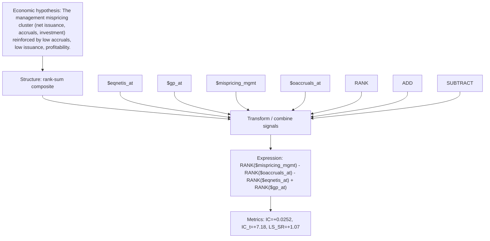

# mispr_mgmt_accrual

- **Family:** ``
- **Structure:** rank-sum composite
- **Fields:** `$eqnetis_at, $gp_at, $mispricing_mgmt, $oaccruals_at`
- **Operators:** `RANK, ADD, SUBTRACT`
- **Expression:** `RANK($mispricing_mgmt) - RANK($oaccruals_at) - RANK($eqnetis_at) + RANK($gp_at)`
- **Metrics:** IC=+0.0252, IC_t=+7.18, LS_SR=+1.07