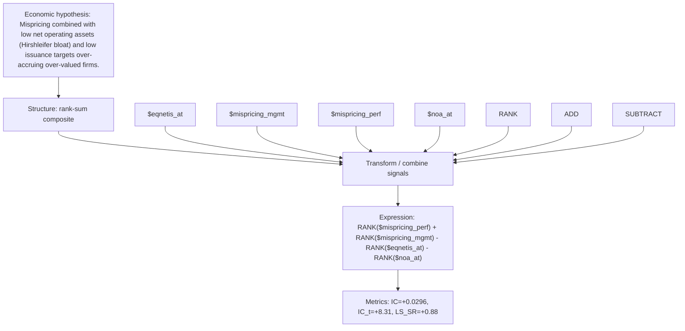

# mispr_noa_disc

- **Family:** ``
- **Structure:** rank-sum composite
- **Fields:** `$eqnetis_at, $mispricing_mgmt, $mispricing_perf, $noa_at`
- **Operators:** `RANK, ADD, SUBTRACT`
- **Expression:** `RANK($mispricing_perf) + RANK($mispricing_mgmt) - RANK($eqnetis_at) - RANK($noa_at)`
- **Metrics:** IC=+0.0296, IC_t=+8.31, LS_SR=+0.88