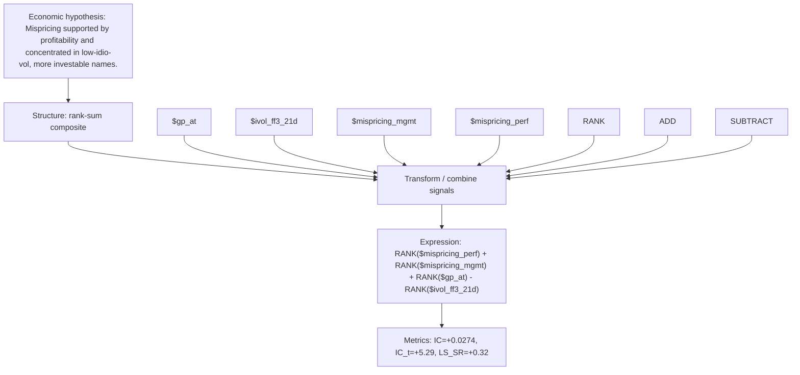

# mispr_profit_lowrisk

- **Family:** ``
- **Structure:** rank-sum composite
- **Fields:** `$gp_at, $ivol_ff3_21d, $mispricing_mgmt, $mispricing_perf`
- **Operators:** `RANK, ADD, SUBTRACT`
- **Expression:** `RANK($mispricing_perf) + RANK($mispricing_mgmt) + RANK($gp_at) - RANK($ivol_ff3_21d)`
- **Metrics:** IC=+0.0274, IC_t=+5.29, LS_SR=+0.32