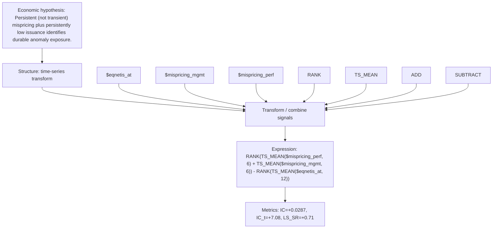

# persistent_mispricing_disc

- **Family:** ``
- **Structure:** time-series transform
- **Fields:** `$eqnetis_at, $mispricing_mgmt, $mispricing_perf`
- **Operators:** `RANK, TS_MEAN, ADD, SUBTRACT`
- **Expression:** `RANK(TS_MEAN($mispricing_perf, 6) + TS_MEAN($mispricing_mgmt, 6)) - RANK(TS_MEAN($eqnetis_at, 12))`
- **Metrics:** IC=+0.0287, IC_t=+7.08, LS_SR=+0.71