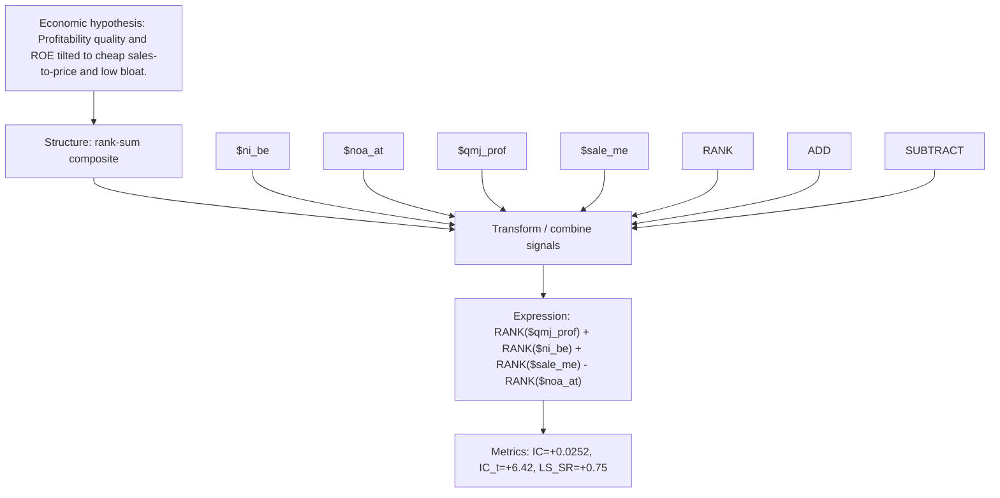

# quality_growth_value

- **Family:** ``
- **Structure:** rank-sum composite
- **Fields:** `$ni_be, $noa_at, $qmj_prof, $sale_me`
- **Operators:** `RANK, ADD, SUBTRACT`
- **Expression:** `RANK($qmj_prof) + RANK($ni_be) + RANK($sale_me) - RANK($noa_at)`
- **Metrics:** IC=+0.0252, IC_t=+6.42, LS_SR=+0.75