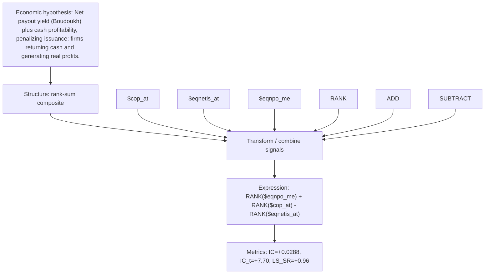

# shareholder_yield_quality

- **Family:** ``
- **Structure:** rank-sum composite
- **Fields:** `$cop_at, $eqnetis_at, $eqnpo_me`
- **Operators:** `RANK, ADD, SUBTRACT`
- **Expression:** `RANK($eqnpo_me) + RANK($cop_at) - RANK($eqnetis_at)`
- **Metrics:** IC=+0.0288, IC_t=+7.70, LS_SR=+0.96