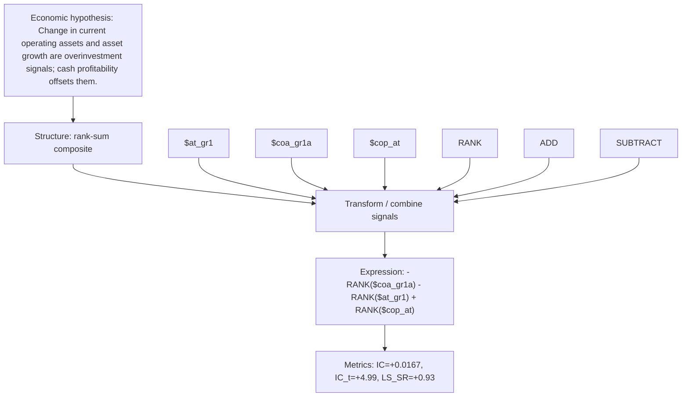

# coa_growth_quality

- **Family:** `llm`
- **Structure:** rank-sum composite
- **Fields:** `$at_gr1, $coa_gr1a, $cop_at`
- **Operators:** `RANK, ADD, SUBTRACT`
- **Expression:** `-RANK($coa_gr1a) - RANK($at_gr1) + RANK($cop_at)`
- **Metrics:** IC=+0.0167, IC_t=+4.99, LS_SR=+0.93