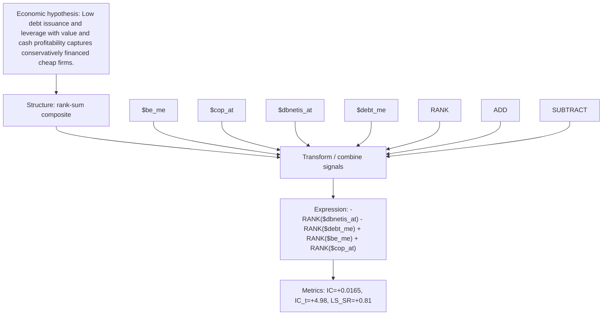

# debt_discipline_value

- **Family:** `llm`
- **Structure:** rank-sum composite
- **Fields:** `$be_me, $cop_at, $dbnetis_at, $debt_me`
- **Operators:** `RANK, ADD, SUBTRACT`
- **Expression:** `-RANK($dbnetis_at) - RANK($debt_me) + RANK($be_me) + RANK($cop_at)`
- **Metrics:** IC=+0.0165, IC_t=+4.98, LS_SR=+0.81