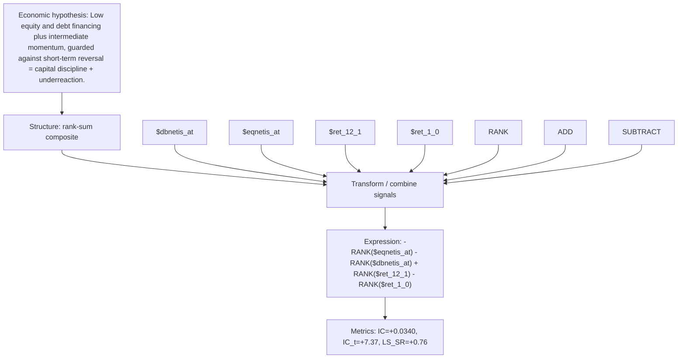

# issuance_mom_reversal

- **Family:** `llm`
- **Structure:** rank-sum composite
- **Fields:** `$dbnetis_at, $eqnetis_at, $ret_12_1, $ret_1_0`
- **Operators:** `RANK, ADD, SUBTRACT`
- **Expression:** `-RANK($eqnetis_at) - RANK($dbnetis_at) + RANK($ret_12_1) - RANK($ret_1_0)`
- **Metrics:** IC=+0.0340, IC_t=+7.37, LS_SR=+0.76