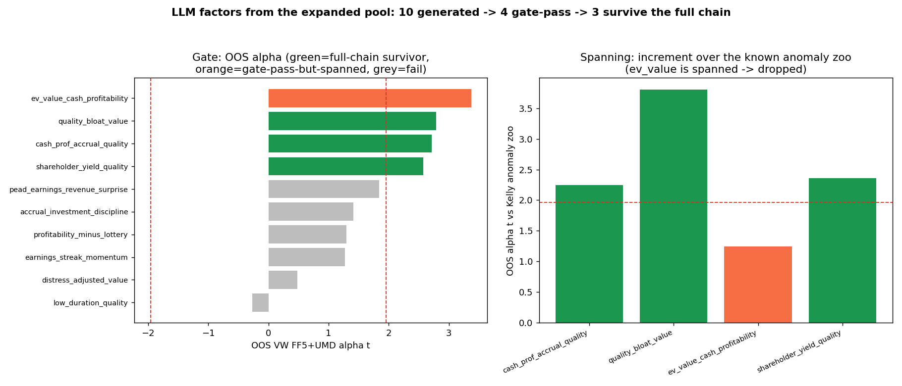

# LLM-generated factors — full-chain survivors

[Project overview](../../README.md) · [Reproduction guide](../../docs/REPRODUCIBILITY.md)

> **Recorded research artifacts.** Interpret tables and figures using this run's data and validation settings.

Factors proposed by the LLM (Claude acting as the LLM, no API) from the **expanded
120-factor Kelly-153 pool + field dictionary**, run through the entire evaluation chain
(gate → spanning vs the anomaly zoo → walk-forward → HLZ multiple-testing → Fama-MacBeth).
Sample 1972-01 .. 2025-12, OOS split 2000-12-31, value-weighted, Newey-West.

Two generation batches were run through the identical chain:
- **additive batch** (10 rank-sum candidates) → `chain/`
- **interaction batch** (10 candidates deliberately using `*`, `/`, `TS_*`) → `chain_interactions/`

## The 5 full-chain survivors (across both batches)

| Factor | Structure | Expression | VW α_t (full/OOS) | zoo α_t (full/OOS) | walk %+ | HLZ | FM t |
|---|---|---|---|---|---|---|---|
| cash_prof_accrual_quality | rank-sum | `RANK($cop_at) - RANK($oaccruals_at) - RANK($eqnetis_at)` | 4.82/2.71 | 4.18/2.24 | 83% | ✓ | 6.4 |
| quality_bloat_value | rank-sum | `RANK($qmj_prof) + RANK($qmj_safety) + RANK($sale_me) - RANK($noa_at)` | 3.67/2.79 | 4.53/3.80 | 100% | ✓ | 6.6 |
| shareholder_yield_quality | rank-sum | `RANK($eqnpo_me) + RANK($cop_at) - RANK($eqnetis_at)` | 3.22/2.58 | 3.25/2.36 | 92% | ✓ | 6.9 |
| earnings_yield_stability | ratio `/` | `RANK($ni_me / ($ni_ivol + 1)) + RANK($cop_at)` | 3.27/2.49 | 2.74/2.59 | 92% | ✓ | 6.2 |
| persistent_mispricing_disc | time-series `TS_*` | `RANK(TS_MEAN($mispricing_perf,6)+TS_MEAN($mispricing_mgmt,6)) - RANK(TS_MEAN($eqnetis_at,12))` | 4.02/2.64 | 3.07/2.19 | 92% | ✓ | 6.4 |

## Structure finding (why it is not "only + / −")

Running both batches through the same strict chain isolates which operator structures survive:

| Structure | Gate-pass rate | Full-chain survivors | Note |
|---|---|---|---|
| additive rank-sum | 4/10 | 3 | robust |
| ratio `/` | 2/3 | 1 (+1 marginal) | survives when the ratio is economically meaningful (risk/vol scaling) |
| time-series `TS_*` | 1/3 | 1 | persistence/trend survives |
| **multiplicative `ZSCORE*ZSCORE`** | **0/3** | **0** | monotonicity breaks, OOS ≈ 0 — consistently dies |

So the survivors are **not** all additive: a ratio (earnings yield scaled by earnings volatility)
and a time-series (persistent mispricing) both survive. But **pure multiplicative interactions
consistently fail** the OOS + monotonicity gate — the "additive/ratio/TS beat multiplicative"
result, reproduced on fresh candidates.

## Chain does real work (spanning example)

In the additive batch, `ev_value_cash_profitability` had the **highest** OOS gate alpha (t=3.37)
but is **spanned by the Kelly anomaly zoo** (zoo α t=1.6/1.2) — its return is explained by known
anomalies, so the chain drops it. The gate alone would have kept it.

## Layout

- `factors/<name>/` — per-factor bundle: `<name>.png` (4-panel chart), `<name>.json`,
  `trees/` (economic derivation tree), `formula_trees/` (formula parse tree).
- `chain/` — full chain tables for the additive batch (all 10 candidates).
- `chain_interactions/` — full chain tables for the interaction batch (all 10 candidates).
- `survivors_summary.csv` — the joined 5-factor survivor table above.
- Sources: `../llm_generated_candidates.json`, `../llm_generated_interactions.json`,
  `../llm_valid_factors.json`, `../llm_valid_interactions.json`.
