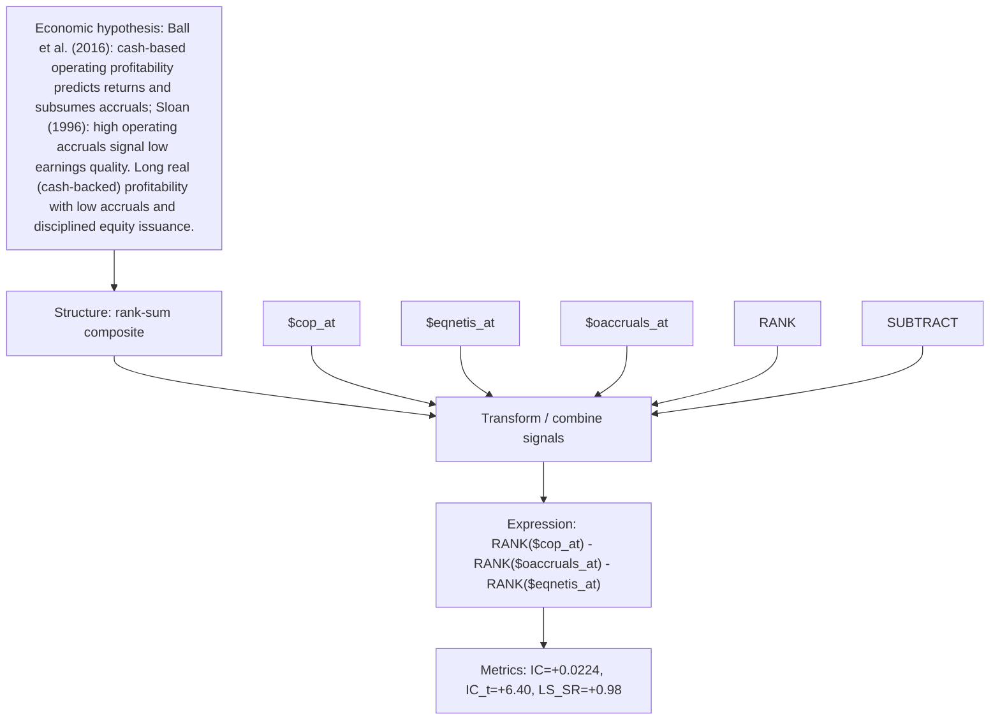

# cash_prof_accrual_quality

- **Family:** ``
- **Structure:** rank-sum composite
- **Fields:** `$cop_at, $eqnetis_at, $oaccruals_at`
- **Operators:** `RANK, SUBTRACT`
- **Expression:** `RANK($cop_at) - RANK($oaccruals_at) - RANK($eqnetis_at)`
- **Metrics:** IC=+0.0224, IC_t=+6.40, LS_SR=+0.98