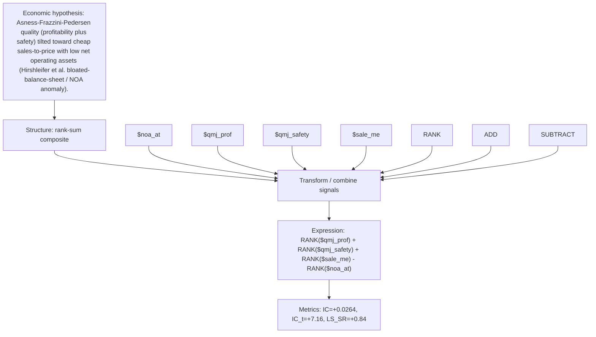

# quality_bloat_value

- **Family:** ``
- **Structure:** rank-sum composite
- **Fields:** `$noa_at, $qmj_prof, $qmj_safety, $sale_me`
- **Operators:** `RANK, ADD, SUBTRACT`
- **Expression:** `RANK($qmj_prof) + RANK($qmj_safety) + RANK($sale_me) - RANK($noa_at)`
- **Metrics:** IC=+0.0264, IC_t=+7.16, LS_SR=+0.84